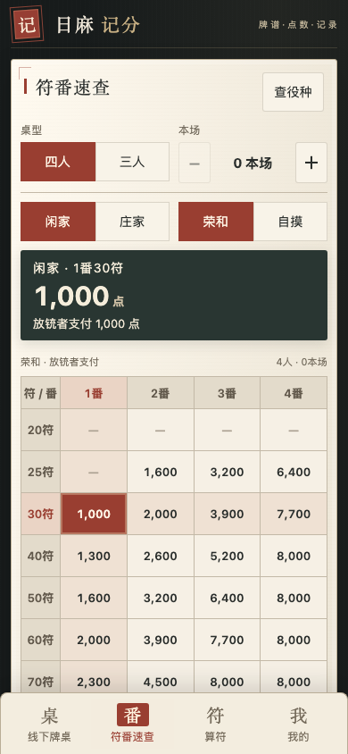
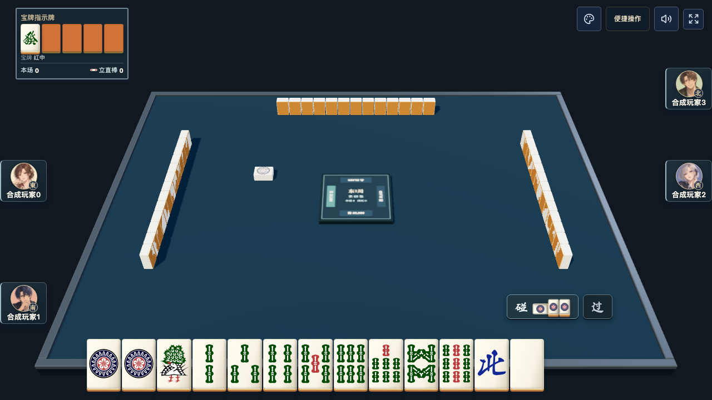

# 日麻记分 · 独立麻将应用

给日本麻将使用的独立手机应用：以记分为首页，扫码入桌，逐局记录各家收支、汇总每圈和整场；查点、查役种与算符随时辅助。

**手机直接访问：[日麻记分](https://yougui.online/riichi/)**。无需情侣空间账号，填写昵称后开桌，通过“扫码入桌”邀请朋友。

这是独立运行的应用，有自己的进程、端口、SQLite 数据库和成员身份；**不需要启动情侣空间，不读取情侣空间账号或资料**。源码：[maxma615/riichi-score](https://github.com/maxma615/riichi-score)。

**当前发布边界（2026-10-19）：微信「雀叙牌谱」只提供线下记分、扫码入桌、符番速查、算符、役种与统计，不包含联机页面、入口、三维运行时、打牌音效或素材。三／四人联机与人机只保留在[网站联机牌桌](https://yougui.online/riichi/online/)。** 原生联机的历史源码已移到发布目录之外的 `archive/native-online/`，供回归与留档，不作为微信游戏发布项目。

## 中国风界面

墨色山景、竖排题签、宋体标题与朱砂印章；符番、点数与逐局记录放在浅色纸页上，配纸纹和细角框。选中项用朱砂色突出，输赢数字保持清晰。查点以四列番数、逐行符数的可点选交叉表为主；选中格高亮，支付结果滚动吸附在顶部。满贯以上按整行继续查询，算符使用独立底部入口。




## 功能

- 连庄与本场醒目显示，按局自动累加；支付明细列基础点数、本场加点和最终支付，本场速查用加减按钮；桌型与本场放在速查顶部默认展开。
- 庄家／闲家、荣和／自摸切换；点击符番交叉格查点，满贯至多倍役满按行选择。
- 点选式算符：门前清荣和、自摸、雀头、听牌形、刻子/杠子，以及七对子和平和例外。
- 月度和牌、被胡、放铳次数、净点及同桌输赢统计；个人总结、和牌率／放铳率、单局最高收支，以及“带福之人／带负之人”；撤回同步重算。
- 役种查番：搜索役名或条件、按番数分组，门清与副露番数同时展示。
- 原生微信小程序客户端与服务端微信登录、头像昵称、小程序码接口；正式微信发布待小程序备案与真机验收。
- 四人和三人线下记分。本场、立直供托、连庄、换庄、荒牌听牌罚符、途中流局。
- 多人荣和先选放铳者、再点选赢家，仅展开选中者的独立符番；分别记分，供托归头家；四麻三家荣和按途中流局记录。
- 记分按“谁和牌 → 自摸／荣和 → 放铳人 → 符番”点选，支持双响；记分表单无需下拉框。
- 历史列表点进详情查看牌谱，撤回与删除位于详情最底部；误开的空桌可直接删除。扫码自动加入空位，首次记分前可整行拖动排序、换人并选择起庄；立直为大块点选。
- 东风场／半庄点选，最后一局换庄后自动结算，连庄继续。结束页显示名次、总点数与净点数，醒目的“原班人马再开一场”保留成员身份及规则、重置点数；多人同时续桌进入同一张新桌。既有自由场仍可手动结束。
- 我的 → 对局历史记录：查看全部已参与牌桌、结束状态、本人净收支和逐局牌谱，按固定账号身份关联，改名保留记录。
- 二维码邀请、成员昵称与座位。入桌成员均可记分、撤回、结束牌局和代填线下玩家；起庄玩家在首次记分前明确选择。
- 逐局历史、每圈汇总、累计点数、撤回最近记录、结束牌局和最近牌桌列表。
- 数据库事务、重复请求去重、并发版本检查，服务重启后保留记录。

输入双方确认的符番，不自动识别牌型和役。宝牌不能单独形成役。包牌、流局满贯、错和罚分、终局顺位马点暂不支持；不要使用普通和牌代替。结束时未领取的供托继续单独显示，不擅自分配。

规则按桌保存：四麻25000／三麻35000起点；默认不切上满贯、开启累计役满。三麻自摸损，本场荣和200／自摸每家100；荒牌罚符总额3000。实际雀魂当前规则没有登录客户端逐项核验，此版本不宣称完全复刻雀魂。

## 独立启动

需要 Node.js 24+。单独克隆并启动，无需有归仓库：

```sh
git clone https://github.com/maxma615/riichi-score.git
cd riichi-score
npm ci --cache .local/npm-cache
cp .env.example .env
npm run build
npm start
```

打开 `http://127.0.0.1:3200/`。运行数据默认保存在本目录 `.local/data/`，不进 Git；上线时把 `DATA_DIR` 指向单独持久化目录。无需 PostgreSQL、Next.js、情侣空间或雀魂账号。

手机扫码需要所有人的设备都能访问 `APP_ORIGIN`。本机回环地址无法给另一台手机访问。局域网测试可设 `HOST=0.0.0.0`、`APP_ORIGIN=http://本机局域网IP:3200`；公网使用可信 HTTPS。`APP_BASE_PATH=/riichi` 可以部署到既有网站的独立路径，反向代理应保留路径。

身份由当前浏览器的 HttpOnly Cookie 保存90天；昵称不是经过验证的微信身份，清除 Cookie 或更换设备不会自动恢复桌主身份。邀请码允许加入空座位，入桌后可共同管理牌桌；收藏链接、保留浏览器会话后可回到原桌。服务端微信登录已经接入，实际微信身份登录仍需配置AppID、AppSecret与备案域名。

## 容器部署

```sh
# .env 中 APP_ORIGIN 配置为真实公网 HTTPS 源站。
docker compose up -d --build
```

容器只在本机3200端口监听，前置 HTTPS 代理自行配置；`score_data` 是独立卷。默认限制0.25 CPU和256 MiB内存。已经在上海 ECS 验证容器限制、健康与独立卷；测试记录见docs/acceptance.md，不要对真实资料自动生成或下载备份。小程序需要备案域名、合法 HTTPS request 域名、AppID、微信服务端登录和小程序码，网页二维码不能冒充小程序码。

## 检查

```sh
npm test # 自动先构建联机服务和前端，再运行服务与规则检查
npx playwright install chromium webkit
npm run test:browser
npm run test:mini:layout # 仅历史原生牌桌档案布局回归，不属于记分发布包
```

测试只用合成昵称和临时数据库。浏览器截图在 `.local/browser/`，不提交运行数据。测试覆盖真实 HTTP 权限、来源校验、数据库重启、并发、幂等、计分与撤回，浏览器流程还将二维码截图解码后在另一个独立会话加入。

[当前目标验收核对](docs/goal-audit.md) · [两套应用的边界](docs/applications.md) · [实现设计](docs/design.md) · [验收状态](docs/acceptance.md) · [下一阶段微信小程序](docs/wechat-plan.md)

部署目录、独立数据卷、HTTPS 接入与后续升级见[服务器部署说明](docs/deployment.md)。

原生小程序导入、服务器配置与验收边界见[小程序接手](docs/wechat-plan.md)。

记分时番数用加减按钮、符数直接点选，役满用选择项；每位赢家的符番独立，支付预览实时更新。

## 独立联机牌桌

网页版牌桌已改为Three.js/WebGL真实几何渲染：圆角牌体有独立宽、高、厚，统一透视相机、光照、阴影和深度遮挡；对手站牌、弃牌、立直横牌、副露、加杠叠牌与拔北共用世界坐标。本人手牌仍使用原交互控件，拖放落点与飞牌端点读取三维投影。空闲按需绘制，设备像素比最高1.5；不增加服务器几何计算。



`npm run test:online:webgl` 验证网页真实WebGL深度缓冲、手机／桌面物件、碰牌／拔北、空闲绘制与context恢复；`test:online:depth`运行同一验证。网页保留立直自动摸切、拖牌、吃碰杠、逐役结算和原创合成音效。

`/online/`提供三人／四人日本麻将和电脑补位，使用本应用的昵称身份。规则、原有牌面、桌面动效和结算组件已经移入本仓库；不再调用有归的登录、数据库或联机接口。记分仍是首页，右上角进入联机牌桌。

本地先运行`npm ci`、`npm run build`、`npm start`。联机进程只在开桌时启动，无桌60秒后停止；所有桌共用一个有内存和时间限额的电脑决策线程。重启或进程异常会清空未完成的联机牌桌，线下记分数据库不受影响。运行容器的总上限为0.25 CPU／256 MiB。

特殊动作可单独执行 `npm run test:online:interactions`：两种浏览器共18个固定牌局流程，覆盖立直、自摸、拔北后补牌自摸、吃碰、明杠／暗杠／加杠和双人荣和到下一局。此命令挂载真实牌桌组件与规则／RoomStore到隔离回环测试服务，使用守恒的实体牌山；身份、生产HTTP和Socket.IO验证仍由下面的真实服务测试负责。产物在`.local/browser/online-interactions/`，无生产调试接口。

验证命令：`npm test`（当前项数见docs/acceptance.md，包含独立服务／小程序逻辑检查及规则回归）、`npm run test:browser`、`npm run test:online:browser`。规则回归也可单独运行`npm run test:rules`，包含四麻／三麻、立直、拔北、听牌、人数／房主权限及多人结算。新增真实进程测试覆盖双人入桌、三／四麻电脑补位、独立身份、私有手牌、非房主权限、请求幂等、解散同步、按需停止和异常退出后线下服务可用。

## 小程序开发与验证

原生发布项目在 `miniprogram/`，只包含7个线下工具页面。公开配置使用游客占位值，正式 AppID 只保存在 Git 忽略的 `miniprogram/project.private.config.json` 中，API前缀为 `https://yougui.online/riichi`。当前小程序备案审核中，预览不等于提交审核或正式发布。

`npm run sync:mini` 只同步线下计分、算符、役种、速查和支付明细，不生成联机代码。微信用户主动选择头像、填写昵称；后台用 OpenID 关联身份和历史，不需要手机号或密码。线下扫码、选座及小程序码接口保留；外部微信扫码仍需核对目标版本可用性。

`tests/mini-score-only.test.js` 扫描完整发布目录，检查没有隐藏联机路由、联机API调用、WebGL运行时或打牌资源，并保留扫码记分入口。`npm test` 还继续运行移出发布目录的历史原生联机回归；`test:mini:layout`和`test:mini:webgl`仅检查该档案，不代表当前记分小程序包含联机功能。重建档案的独立命令见[原生牌桌档案](archive/native-online/README.md)。

平台编译、预览及尚缺验收见[开发者工具记录](docs/devtools-current.md)和[小程序接手](docs/wechat-plan.md)。服务器密钥仅保存在受保护环境文件中，勿提交到仓库。
